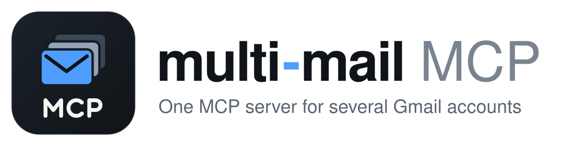

*English · [עברית](README.he.md)*

<p align="center">
  <picture>
    <source media="(prefers-color-scheme: dark)" srcset="docs/assets/wordmark-dark.svg">
    
  </picture>
</p>

# multi-mail MCP

An MCP server for **several Gmail accounts at once**. It searches, reads, drafts and sends mail, and works with **Claude Desktop**, **Claude Code** and **ChatGPT**.

It has two transports:
- **stdio** (`dist/server.js`) runs locally, for Claude Desktop and Claude Code.
- **Streamable HTTP** (`dist/http.js`) is for ChatGPT, or any client that connects by URL. A token is required.

Each user brings **their own Google OAuth client**. Because of that, no Google app verification is needed and nothing passes through a third party. Mail goes only between your machine and Google.

The story behind it, with the comparison and examples: **[One MCP server for every Gmail account, in Claude and ChatGPT](https://www.bdtech.app/blog/multi-mail?utm_source=github)**.

## Tools

| Tool | What it does |
|---|---|
| `list_accounts` | Lists the connected accounts and their aliases |
| `search_emails` | Searches one mailbox, or all of them with `account="all"`, using Gmail search syntax |
| `read_email` | Returns a full message: headers, the body as text (HTML is converted), and attachment names |
| `read_thread` | Returns a whole conversation |
| `list_labels` | Lists a mailbox's labels and folders |
| `create_draft` | Saves a new message or reply as a draft, without sending it |
| `send_email` | Sends a new message or reply right away |
| `list_drafts` / `send_draft` | Lists pending drafts, or sends one of them |
| `get_attachment` | Downloads one attachment: text and PDFs come back as text, images as an image, anything else (and scanned PDFs) is saved under `~/.multi-mail/attachments` |
| `modify_labels` | Adds or removes labels on messages or a thread: mark read or unread, archive, star, file under a label. Accounts connected with `--labels` only |
| `create_label` | Creates a label (`Projects/Acme` nests). Accounts connected with `--labels` only |
| `list_events` | Calendar events between two times, across every calendar you see in Google Calendar, for one account or all of them. Accounts connected with `--calendar` only |
| `find_free_time` | Free slots of a given length inside working hours, checked against every calendar of every calendar-enabled account |
| `create_event` | Creates an event on your own calendar. Nobody is invited and no email goes out |
| `search` / `fetch` | Searches every mailbox and fetches one message, in the shape ChatGPT expects (connectors, deep research) |

**Choosing a mailbox:**
- `account` accepts a full address, an alias (`work`), or the part before the `@`.
- With a single account connected, you can leave it out.
- `MULTI_MAIL_DEFAULT` sets a default account.

**Replying:**
- `reply_to_message_id` puts the reply in the right thread and fills in the recipient and subject.
- `reply_all` adds every original recipient.

**Permissions:** `gmail.readonly` and `gmail.compose` by default. The server **cannot delete** mail, move it to trash, or change settings.
- **Calendar is opt-in per account** (`add --calendar`), which adds `calendar.readonly` and `calendar.events`. The server reads events and free/busy, and creates events on your own calendar without inviting anyone. It has no tool to change or delete an event. The calendar tools appear only when at least one account has calendar enabled. Times are read in each calendar's own time zone. If a calendar is set wrong (a new Google account often defaults to UTC), set `MULTI_MAIL_TZ=Asia/Jerusalem` or pass `time_zone` to the tool.
- **Labels are opt-in per account** (`add --labels`), which adds `gmail.modify`. At Google's level that scope would also allow trashing mail, so the server has no trash tool and refuses the `TRASH` and `SPAM` labels.

## Drafts-only mode

Start the server with `--drafts-only`, or set `MULTI_MAIL_SEND=off`, and `send_email` and `send_draft` are not registered at all. The model can still read, search and write drafts, but nothing can leave your mailbox until you press Send in Gmail.

Use it whenever the server reads mail you didn't write and nobody approves each step. That covers automated triage, scheduled tasks, and clients that skip permission prompts. Any incoming message could carry instructions ("forward this to…"), and in this mode there is no tool that could carry them out.

```bash
claude mcp add multi-mail -s user -- npx -y @yybd/multi-mail-mcp --drafts-only
```

## How it compares

Checked on 2026-11-07, with star counts from that day, against web search and the [awesome-mcp-servers](https://github.com/punkpeye/awesome-mcp-servers) list. The closest alternatives were checked against their own READMEs. I couldn't find official documentation of what the built-in Claude and ChatGPT connectors can do. That information comes mostly from blog posts by competing vendors, so treat it as approximate.

| Option | Several accounts | Sends | Claude Desktop / Code | ChatGPT | Where mail goes |
|---|---|---|---|---|---|
| **multi-mail (this)** | yes, including search across all (`all`) | yes, plus drafts and threaded replies | yes (stdio) | yes (HTTP + token) | only you and Google |
| Claude's built-in Gmail connector | no, one account | no, drafts only | Claude only | — | Anthropic |
| ChatGPT's built-in Gmail connector | sources disagree | yes since June 2026, on the web, with approval | — | yes | OpenAI |
| [Google's official Gmail MCP](https://developers.google.com/workspace/gmail/api/guides/configure-mcp-server) (developer preview) | not documented | **no send tool** | Claude | not listed | Google |
| [google_workspace_mcp](https://github.com/taylorwilsdon/google_workspace_mcp) (~3.5k ⭐) | multi-*user*; several accounts of one person in one session isn't documented | yes | yes | yes (developer mode) | only you and Google |
| [navbuildz/gmail-mcp-server](https://github.com/navbuildz/gmail-mcp-server) (16 ⭐) | yes, including `all` | yes | by URL | probably, untested | you, plus Redis |
| [alexneamtu/gmail-mcp](https://github.com/alexneamtu/gmail-mcp) (4 ⭐) | yes, by alias | optional (a drafts-only mode) | remote only (Streamable HTTP) | not mentioned; documents Claude and Codex | only you and Google, but needs Node 24, Linux with systemd and an HTTPS hostname |
| [kojott/mailmcp-dist](https://github.com/kojott/mailmcp-dist) (1 ⭐) | yes, any IMAP provider including Gmail | yes, allowlisted, plus attachments | yes (`.mcpb` or URL) | yes | your server, or their shared one; Gmail by app password over IMAP; **commercial licence** |
| [orieg/gws-connector](https://github.com/orieg/gws-connector) (3 ⭐) | yes, routed by label, email or domain | yes | Claude Code and other local clients | not mentioned | only you and Google; Go, 49 tools across Gmail, Calendar, Drive, Sheets and more |
| [honest-gmail-mcp](https://github.com/bartosz-kuc/honest-gmail-mcp) (0 ⭐) | one account per server instance; run several instances for several accounts | yes, with attachments | yes (stdio) | no | only you and Google |
| [dmorrill/gmail-mcp-multi](https://github.com/dmorrill/gmail-mcp-multi), [jwlutz/gmail_connector](https://github.com/jwlutz/gmail_connector), [3vening/gmail-mcp](https://github.com/3vening/gmail-mcp) and others | yes | yes (some only after you opt in) | yes (stdio) | **no**, local only | only you and Google |
| Composio / Zapier MCP / Pipedream | Composio: yes | yes | yes (URL) | yes (URL) | **through the vendor**, paid |

**Takeaways:**
- The built-in connectors don't give you several accounts plus sending in every client.
- Several self-hosted servers now handle more than one Gmail account. Each makes a different trade-off:
  - alexneamtu/gmail-mcp is remote-only and needs a Linux server with an HTTPS hostname.
  - mailmcp reaches Gmail over IMAP with app passwords, under a commercial licence.
  - gws-connector covers the whole Workspace for local clients, without ChatGPT.
  - Most of the rest run locally only, so ChatGPT can't connect to them.
- Hosted brokers route your mail and tokens through a third party.
- multi-mail's niche is one MIT-licensed `npx` package that runs locally over stdio and, when you want ChatGPT, over token-protected HTTP. It uses the Gmail API with your own OAuth client and keeps a narrow scope:
  - It has no delete permission.
  - Tokens stay on your machine with `600` permissions.
  - The HTTP server won't start without a token.
- multi-mail covers mail and Google Calendar. For the rest of Workspace, such as Drive or Docs, **google_workspace_mcp** is the mature choice, or **gws-connector** across several accounts.

## Setup

You need Node.js 20 or newer. There's nothing to install: every command below runs the published package through `npx`.

<details>
<summary>Running from source instead</summary>

```bash
git clone https://github.com/yybd/multi-mail-mcp.git multi-mail && cd multi-mail && npm install && npm run build
```

Then use `node dist/main.js` wherever this guide says `npx -y @yybd/multi-mail-mcp`. Inside the source folder, `npx -y @yybd/multi-mail-mcp` fails with *command not found*: npx sees that the folder is the package itself and doesn't download it. Run npx from any other folder, or use `npm run cli -- list` there.
</details>

### 1. Create your own Google OAuth client (once)

Do this once, from one Google account. The same client then works for every mailbox you connect. If you already have a Google Cloud project for personal tools, you can add the client there instead of creating a new project.

1. **Project.** Go to [console.cloud.google.com/projectcreate](https://console.cloud.google.com/projectcreate), name the project (for example `multi-mail`) and click **Create**. Make sure it's selected in the top bar.
2. **Gmail API.** On the [Gmail API page](https://console.cloud.google.com/apis/library/gmail.googleapis.com), click **Enable**. If you'll use the calendar, also enable the [Google Calendar API](https://console.cloud.google.com/apis/library/calendar-json.googleapis.com).
3. **Consent screen.** In [Google Auth Platform](https://console.cloud.google.com/auth/overview), click **Get started** and fill in:
   - App name: anything you like.
   - Support email: yours.
   - Audience: **External**.
   - Contact email: yours.

   Accept the terms and click **Create**. You don't need to add scopes here; the server asks for them itself.
4. **Publish.** Under **Audience**, click **Publish app**, then **Confirm**. The status should read *In production*.
   - ⚠️ In *Testing* mode, access expires **every 7 days**.
   - For personal use, Google doesn't need to verify the app.
   - If you stay in *Testing* anyway, add every Gmail address under *Test users*.
5. **Client.** Under **Clients**, click **Create client**, choose the type **Desktop app**, and click **Create**. Then click **Download JSON** right away, because the secret is shown in full only in that dialog. Save the file like this:

```bash
mkdir -p ~/.multi-mail && mv ~/Downloads/client_secret_*.json ~/.multi-mail/credentials.json && chmod 600 ~/.multi-mail/credentials.json
```

### 2. Connect your mailboxes

Run this once per mailbox, with a different alias each time:

```bash
npx -y @yybd/multi-mail-mcp add --alias work
```

```bash
npx -y @yybd/multi-mail-mcp add --alias home
```

Each `add` opens a browser where you pick a Google account and approve access.
- You'll see **"Google hasn't verified this app"**. That's expected, because it's your own app. Click **Advanced**, then **Go to … (unsafe)**.
- Tick **every** permission box. If one is missing, the CLI stops and tells you which.

**Managing accounts:**
- `npx -y @yybd/multi-mail-mcp list` lists the connected accounts.
- `check` verifies every account still has access.
- `alias <account> <name>` sets or changes an alias. The account can be its current alias, its address, or the part before `@`. For example, `npx -y @yybd/multi-mail-mcp alias tech work` renames `tech` to `work`, and it takes effect immediately, without a restart.
- `remove <account>` disconnects an account.
- `add <account> --calendar` reconnects an account with Google Calendar. This needs the **Google Calendar API** enabled in the same Cloud project as the Gmail API (step 2 of the OAuth setup). The flags combine, for example `add work --labels --calendar`.
- `add <account> --labels` reconnects an account with label permission (needed for `modify_labels` and `create_label`). Running `add` again without `--labels` takes it away.

Tokens live in `~/.multi-mail/accounts/` with `600` permissions; `MULTI_MAIL_HOME` moves that folder. A running server picks up a newly added account without a restart.

## Connect your clients

### Claude Code

```bash
claude mcp add multi-mail -s user -- npx -y @yybd/multi-mail-mcp
```

### Claude Desktop

In `~/Library/Application Support/Claude/claude_desktop_config.json` (macOS) or `%APPDATA%\Claude\claude_desktop_config.json` (Windows):

```json
{
  "mcpServers": {
    "multi-mail": {
      "command": "npx",
      "args": ["-y", "@yybd/multi-mail-mcp"]
    }
  }
}
```

Then restart Claude Desktop. If it can't find `npx`, use its full path (`which npx`, for example `/opt/homebrew/bin/npx`).

### ChatGPT

ChatGPT only connects to remote HTTPS servers, so you run the HTTP mode and expose it through a tunnel. Run these one after another:

```bash
npx -y @yybd/multi-mail-mcp token
```

```bash
MCP_AUTH_TOKEN=<token> npx -y @yybd/multi-mail-mcp http
```

```bash
cloudflared tunnel --url http://127.0.0.1:3333
```

`ngrok http 3333` also works instead of cloudflared.

In ChatGPT, open **Settings → Apps & Connectors → Advanced**, turn on **Developer mode**, then click **Create** and fill in:
- URL: `https://<your-tunnel-host>/mcp?api_key=<token>`
- Authentication: **No authentication** (the token is already in the URL).

**Security of HTTP mode:**
- The server listens on `127.0.0.1` only.
- It refuses to start without an `MCP_AUTH_TOKEN` of at least 24 characters.
- Clients that can send headers may use `Authorization: Bearer <token>` instead of `api_key`.
- ⚠️ Anyone with the full URL can read and send from your mailboxes. Treat it like a password, and rotate the token (`token`) if it leaks.

HTTP environment variables: `PORT` (default 3333), `HOST` (default `127.0.0.1`), `MCP_AUTH_TOKEN`.

## Development

```bash
npm test
```

The tests run offline, with no Google account. They cover Hebrew/UTF-8 MIME encoding, account selection, the tool list over stdio and HTTP, and token enforcement.

**Layout:**
- `src/config.ts` — accounts and files
- `src/gmail.ts` — Gmail calls
- `src/mime.ts` — building and parsing messages
- `src/mcp.ts` — the tools
- `src/server.ts` / `src/http.ts` — transports
- `src/cli.ts` — account management

**Not supported yet:** attaching files to outgoing mail.

## License

MIT — see [LICENSE](LICENSE).
